# ScholarDocX

**A private workspace for students applying to Master's and PhD programmes.** Track universities, professors and deadlines in spreadsheet-style sheets, keep documents in one vault, and use AI tools that find advisors, hunt scholarships and read research papers, with every change to your data confirmed by you first. **Bring your own AI:** connect Claude Code, Cursor or VS Code to your workspace over [MCP](#connect-your-own-ai-app) and let the AI you already use read your deadlines and suggest changes.

Live at **[scholardocx.onrender.com](https://scholardocx.onrender.com)** · React + FastAPI + PostgreSQL (pgvector) · deployed on free tiers.

---

## Screenshots

| | |
|---|---|
| 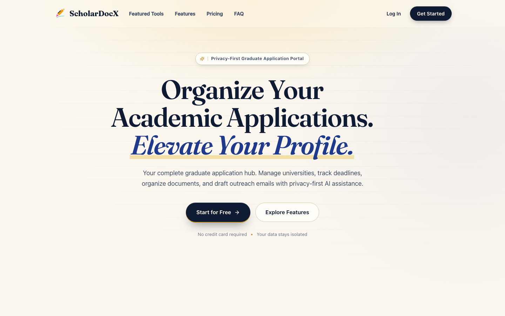 **Landing** | 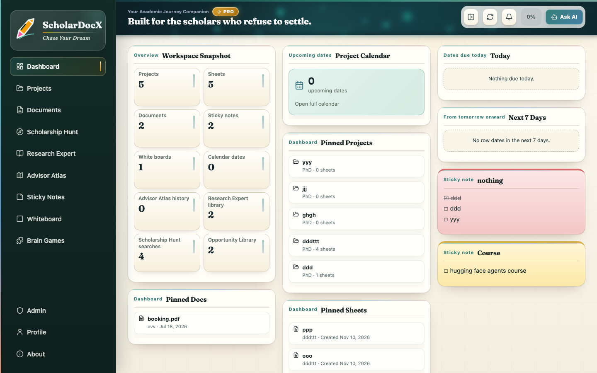 **Dashboard**: counts, pinned items, calendar, notes |
| 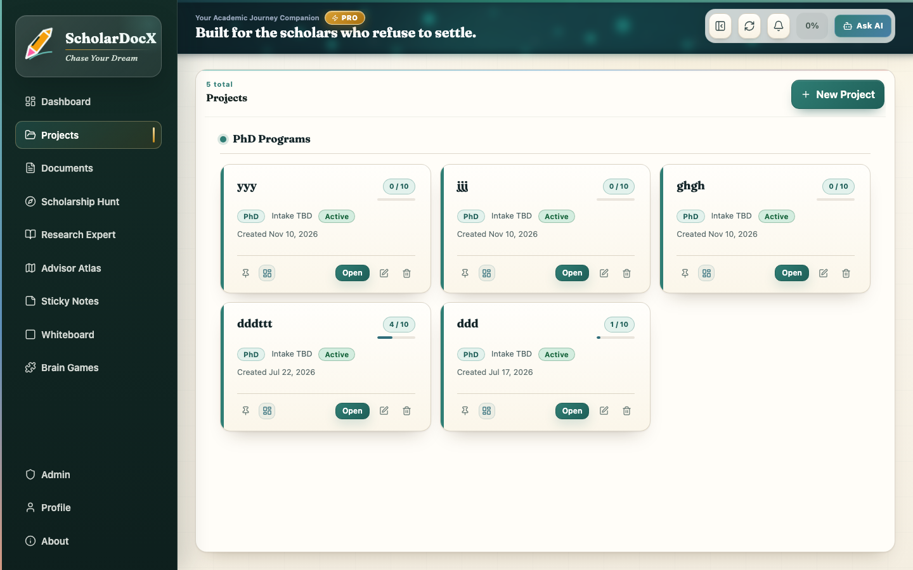 **Projects**: one per application goal | 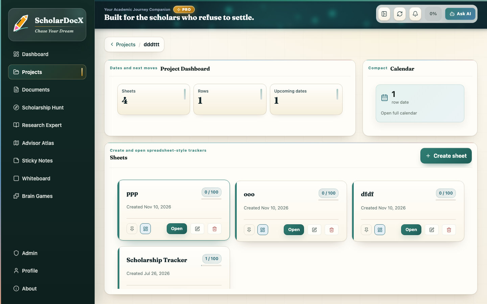 **Project view**: sheets, rows, dates |
| 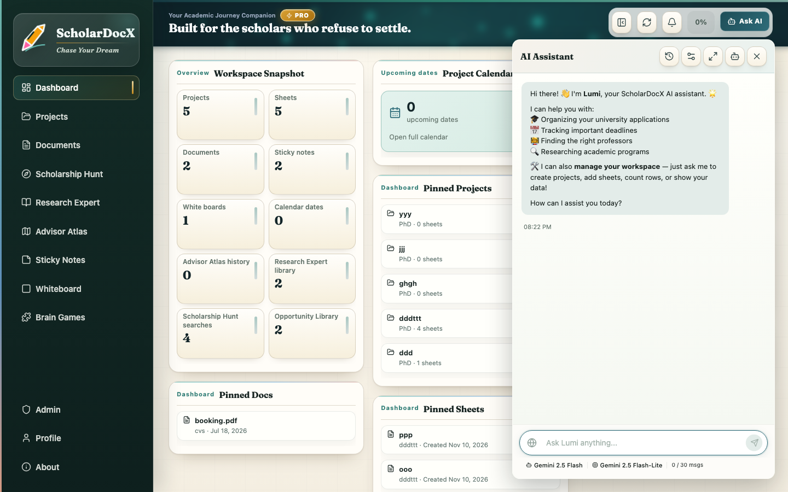 **Lumi, the AI assistant**: chat + workspace agent | 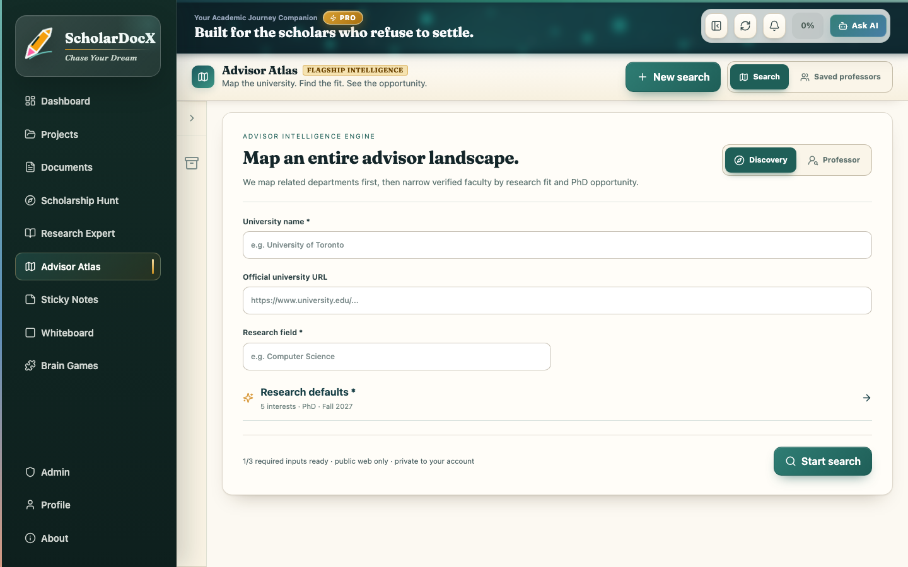 **Advisor Atlas**: find and rank professors |
| 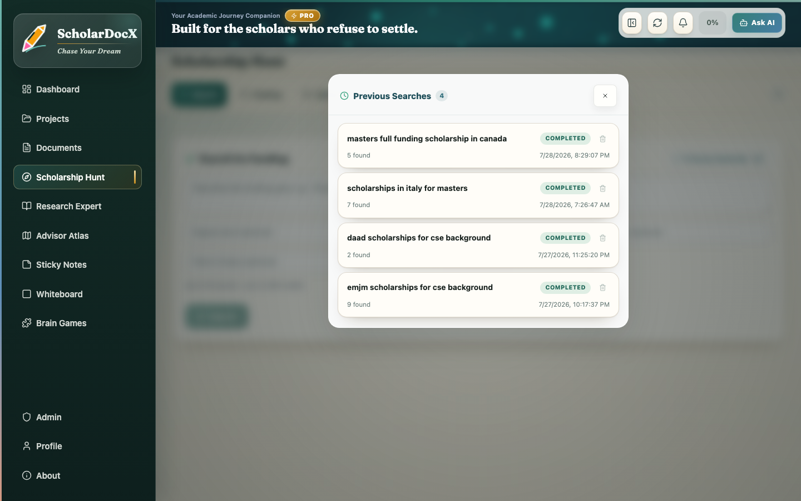 **Scholarship Hunt**: goal-driven funding search | 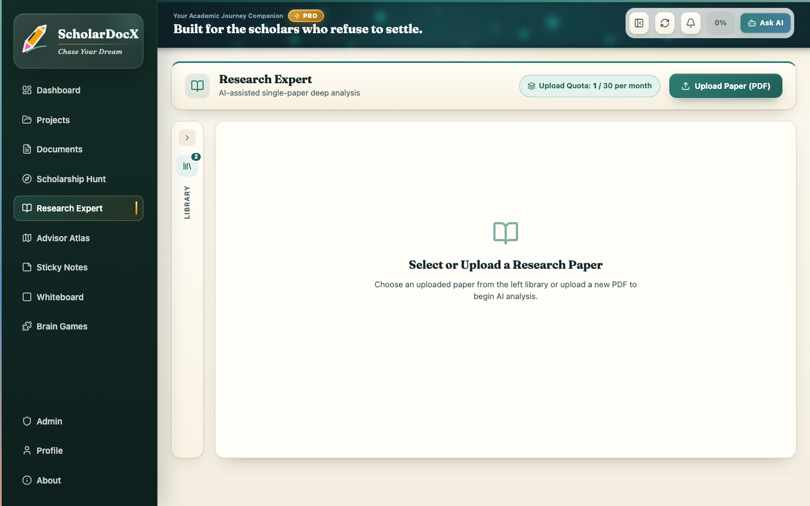 **Research Expert**: ask questions of a paper |
| 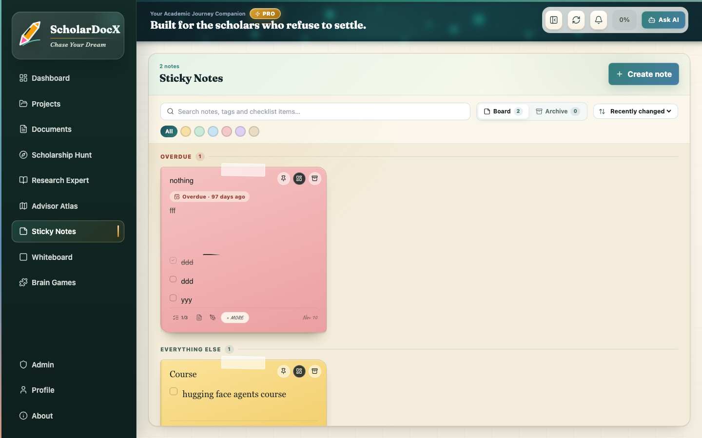 **Sticky notes** with checklists and due dates | |

---

## What's inside

- **Workspace**: projects → sheets → rows with typed columns, cell formatting, CSV import, undo, a calendar fed by date columns, sticky notes, a whiteboard and a document vault.
- **Lumi (AI assistant)**: chat with optional web search, plus a **workspace agent** that reads your data and prepares changes for you to confirm.
- **Advisor Atlas**: maps a university's departments, finds faculty, and builds evidence-backed dossiers on research fit and openings.
- **Scholarship Hunt**: turns a funding goal into searches, reads the pages, and returns structured opportunities.
- **Research Expert**: upload a PDF and ask questions; answers cite the passages they came from.
- **Connected apps**: connect an AI app you already use (Claude Code, Cursor, VS Code) to your workspace over MCP. It can read and *suggest* changes; you confirm each one in the app.
- **Accounts**: email + password with invite codes, or Google sign-in. Plans and AI credits (every AI call is metered).

---

## Architecture

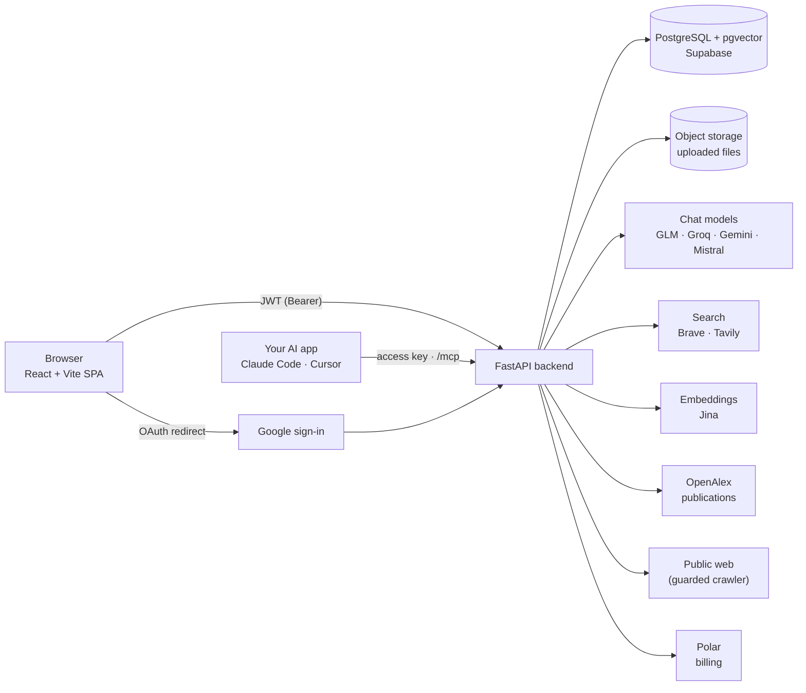

- The browser never talks to an AI or search provider. **All provider keys live only on the server.**
- Every user's rows are scoped by `user_id` in every query; files are opened through short-lived, file-scoped download tokens.
- Every provider call is charged to the user who caused it, checked before the call (`can_spend`) and charged after it. A guard script (`make guard-billing`) fails if any provider call doesn't charge.

---

## Agentic patterns used

The AI features are built from a small set of named patterns ([Building effective agents](https://www.anthropic.com/engineering/building-effective-agents)) rather than one big prompt. Every pattern is bounded (step, concurrency and size caps) and every model call is metered.

| Pattern | Where it lives | How it is used here |
|---|---|---|
| **Tool-use agent** | Workspace assistant: [`ai_agent.py`](backend/app/services/ai_agent.py) · [flow](#how-the-ai-agent-works) | A loop of at most 5 model calls over a fixed catalogue of 40+ typed actions, exposed as two tools: `run_read_action` and `propose_changes`. Reads run inside the loop; model output is validated against the catalogue and never executed as code. The same read/propose split is [served to external AI apps over MCP](#connect-your-own-ai-app). |
| **Routing** | [`ai.py`](backend/app/services/ai.py), [`ai_actions.py`](backend/app/services/ai_actions.py) · [scope](#keeping-the-ai-on-task-prompt-injection-and-scope) | A cheap classifier call decides whether a question needs a live web search and writes the query; if it fails, the system searches. Account and admin requests are refused by pattern before any model runs. |
| **Prompt chaining** | Scholarship Hunt: [`scholarship_deep_hunt.py`](backend/app/services/scholarship_deep_hunt.py) · [pipeline](#how-scholarship-hunt-works) | Goal → query planner → search → snippet pre-filter → crawl → structured extraction → relevance judge → expiry and duplicate gates. Each model step feeds the next, with deterministic checks in between. |
| **Orchestrator–workers** | Advisor Atlas: [`service.py`](backend/app/services/advisor_atlas/service.py), [`analysis.py`](backend/app/services/advisor_atlas/analysis.py) · [pipeline](#how-advisor-atlas-works) | A code-driven orchestrator decides the sub-tasks at run time (units → candidate professors) and fans out bounded parallel workers (screening ×4, deep research ×2). Each deep-research worker runs four specialist passes and a final synthesis call. |
| **Evaluator** | Hunt's relevance judge: [`deep_hunt_query_planner.py`](backend/app/services/deep_hunt_query_planner.py) · the agent's validator · Atlas source checks | One batched judge call scores every extracted opportunity against the goal and the form filters, with a deterministic keyword fallback. The agent's validator returns errors to the model so it can fix a proposal. Atlas claims are checked against the sources they cite. |
| **Human-in-the-loop** | Every workspace write: [`ai_agent.py`](backend/app/services/ai_agent.py), `/ai/actions/execute` in [`routes.py`](backend/app/api/routes.py) | Writes are only ever proposed. The user confirms, an unanswered plan is marked superseded when they move on, and role limits are re-checked at execution. |

Each AI step has a non-AI fallback where one is possible (single-shot planner, keyword relevance match, search-by-default routing, deterministic dossier), so a provider outage degrades a result instead of failing a run.

---

## How the AI agent works

The assistant is connected to the workspace through **two tools**, in a bounded tool-calling loop (at most 5 model calls per message). Reads run immediately; **writes are only ever proposed**.

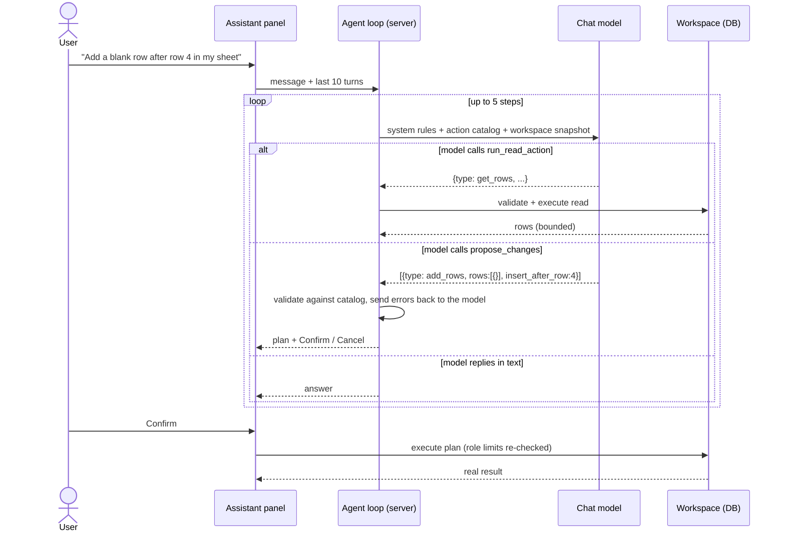

- The model only produces **JSON action objects** from a fixed catalog; they are normalized and resolved by name on the server. Model output is never executed as code.
- Writing data takes a human click. An unanswered plan is marked *superseded* as soon as the user asks for something else.
- If a model can't do tool calling, a single-shot planner takes over automatically.

---

## Connect your own AI app

**Use the AI you already pay for on your own application data.** Basic, Pro and Max users can connect an AI app (Claude Code, Cursor, VS Code) to their workspace through a remote [MCP](https://modelcontextprotocol.io) server. The app can read projects, sheets, rows and deadlines and **suggest** changes; nothing changes until you confirm in ScholarDocX. ScholarDocX makes no model call on this path, so it uses none of your AI credits.

Things you can ask once connected:

- *"What deadlines do I have in the next 14 days across my MSc project?"*
- *"Which rows in my Professor Shortlist have no reply yet?"*
- *"Add a row for TU Munich, MSc Informatics, deadline 15 January."* The app proposes it, you click Confirm in ScholarDocX.

1. Profile → **Connected apps** → **Connect an app**. Choose *Can read* or *Can read and suggest changes* and copy the access key (shown once).
2. Add it to your app, for example in Claude Code:

```bash
claude mcp add --transport http scholardocx <backend-url>/mcp --header "Authorization: Bearer <access key>"
```

Cursor and VS Code take the same URL and header in their MCP settings file; the app shows ready-made snippets.

**Tools** (typed, static): `list_projects`, `list_sheets`, `get_rows`, `search_rows`, `filter_rows`, `get_deadlines`, `get_overdue_rows`, `get_dashboard`, and `propose_changes`.

**Security model**

- Access keys are separate from login sessions: random, only a hash is stored, header-only, expiring, revocable, capped at 5 per user, and killed by the same `token_version` bump as "log out everywhere".
- A session token is refused at `/mcp` and an access key is refused everywhere else.
- Writes are only *suggestions*, stored on the server and run by id when you confirm, with your own plan limits. Deletes, bulk edits, documents and outreach records are not reachable.
- Rows can contain pasted text, so tool results are labelled as data, and a hostile row can at worst create a suggestion you dismiss.
- Per-key rate limits, `Origin` checks, and logs that never contain keys or arguments. Design notes: [AI-Context/technical/mcp-server.md](AI-Context/technical/mcp-server.md).

---

## How the web crawler works

Advisor Atlas and Scholarship Hunt share one crawler, built to be polite and to never reach private networks.

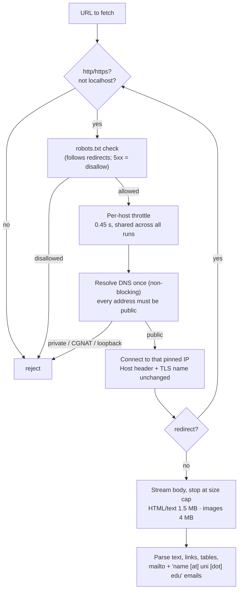

- **DNS-rebinding safe**: the address that was checked is the address that is connected to.
- Every redirect hop is re-validated, robots-checked and throttled again.
- Scraped text reaching a model is labelled *untrusted data, never instructions*; images are sent to the vision model as the bytes that were validated, never as a URL for the provider to fetch.

---

## How Scholarship Hunt works

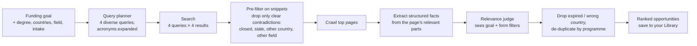

- Missing facts stay empty; the extractor is told never to guess a deadline, amount or sponsor.
- All-fields programmes (e.g. national government scholarships) are kept but ranked below field-specific ones.
- Results live on the run until you save one; your Library holds up to 100.

---

## How Advisor Atlas works

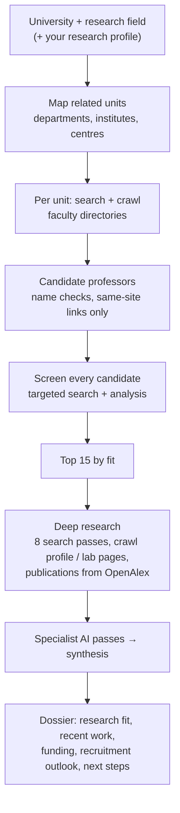

- A missing fact is acceptable; an invented one is not. Model output is checked against the sources it cites and reconciled with deterministic checks (name-matched emails, publication authorship, profile ownership).
- Publications come from the OpenAlex index rather than scraping, and Google Scholar restrictions are never bypassed.
- **Professor mode** skips discovery and runs the deep pass on one named professor.

---

## Sign-in: Google OAuth

Authorization Code flow with **PKCE**; the code exchange happens on the server, so no OAuth secret ever reaches the browser.

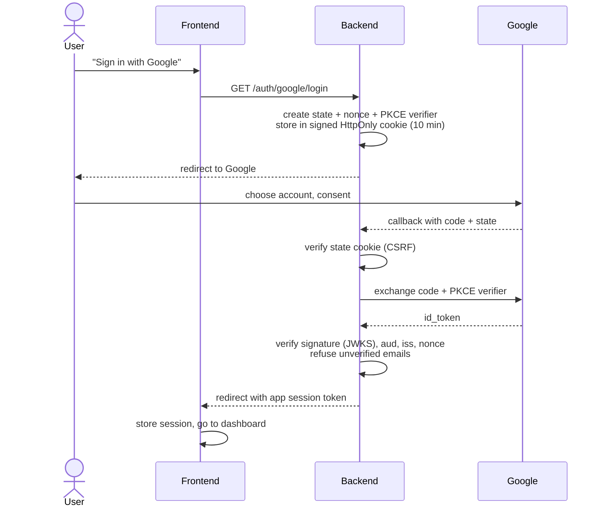

- A verified Google email that matches an existing account is linked to it; nothing else is auto-linked.
- Only the identity is kept: no Google access or refresh tokens are stored.

---

## Sessions, secret rotation and "log out everywhere"

Sessions are signed JWTs (HS256, algorithm pinned on decode). Each token carries the user's `token_version`, and **every request compares it with the database**.

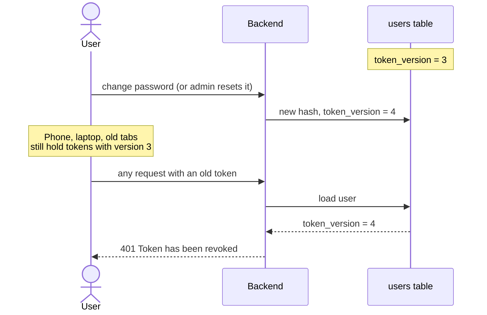

`token_version` is bumped on **password change, admin password reset, suspension and admin revocation**, so all existing sessions die at once without a token blocklist.

**Secrets and rotation**

- The signing secret comes only from the environment (`JWT_SECRET`); there is no fallback value. A placeholder secret that was once committed to the repo is recognised and refused.
- **Rotating `JWT_SECRET` signs every user out at once.** That is the response to a suspected leak.
- Provider keys (AI, search, embeddings, billing, Google OAuth) are server-side environment variables, so they can be rotated without a code change or a client release.
- File links use separate **5-minute, single-file download tokens**, so the long-lived session token never appears in a URL.

---

## Keeping the AI on task (prompt injection and scope)

Defences are layered, so no single prompt is the only line of defence:

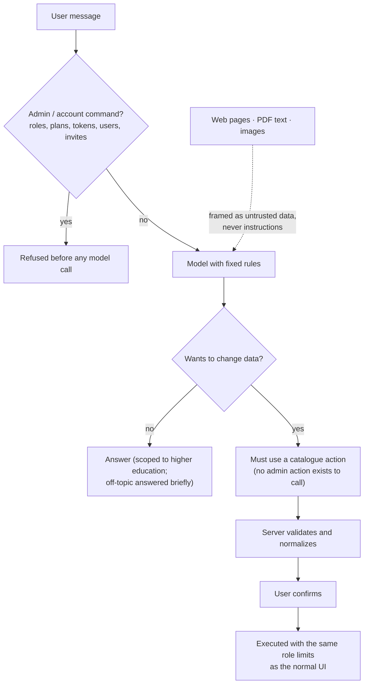

- **Commands for privileged actions go nowhere**: they are refused by pattern before the model runs, and the action catalogue simply has no admin actions for a model to call even if it tried.
- **Content is data, not instructions**: scraped pages, paper passages and images are explicitly framed as material to analyse; text inside them that tries to change the task is ignored.
- **No hidden side effects**: the model cannot write anything by itself. Every write is a typed action, validated on the server and confirmed by the user.
- **No false claims**: plain chat has no workspace access and is told never to say it changed anything.

---

## How chat memory works

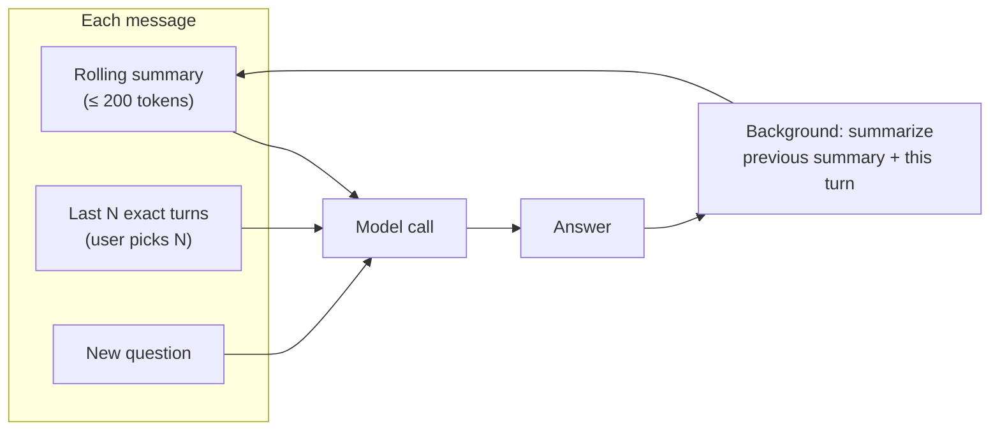

- After each reply, a cheap background call folds the newest turn into the **rolling summary**, keeping goals, decisions, names and deadlines and dropping small talk.
- Each request sends the summary plus the **last N turns verbatim**, so long chats stay cheap and still remember context.
- Chat history is stored in the browser **per user** (keyed by account), so people sharing a computer never see each other's chats.
- With web search on, a small routing step first decides whether a live search is needed at all.

---

## Tech stack

| Layer | Choice |
|---|---|
| Frontend | React 19, TypeScript, Vite 6, Tailwind |
| Backend | FastAPI (Python 3.13), SQLAlchemy |
| Data | PostgreSQL + pgvector (Supabase), object storage |
| AI | GLM, Groq, Gemini, Mistral, OpenRouter · Jina embeddings |
| Search & data | Brave, Tavily, OpenAlex |
| Auth & billing | JWT, Google OAuth (PKCE), Polar |
| Integrations | Remote MCP server (Streamable HTTP, scoped access keys) |
| Hosting | Render (free tier) |

## Running it locally

```bash
make setup     # backend venv + frontend packages
make run       # FastAPI on :8000, Vite on :5173
make test      # backend pytest + frontend vitest
```

The backend reads its configuration from `backend/.env`: at minimum `DATABASE_URL` and `JWT_SECRET`, plus whichever provider keys you want enabled (for example `GLM_API_KEY`, `BRAVE_API_KEY`, `TAVILY_API_KEY`, `JINA_API_KEY`, `GOOGLE_CLIENT_ID` / `GOOGLE_CLIENT_SECRET`). Features whose keys are missing fall back gracefully or show as unavailable.

Backend tests run against a throwaway Postgres: `make test-db-start` (Docker).

## Repository layout

```
backend/     FastAPI app: api/ (routes), services/ (features, AI, crawler), auth/, db/
frontend/    React app: components/, lib/, contexts/
AI-Context/  living product + technical context and task history (AI-assisted development)
scripts/     guards: provider-call billing, context drift, CSS invariants
```

This repository is developed with an **AI-assisted workflow**: every change starts from a task in `AI-Context/jira-tasks/` and keeps the context files in `AI-Context/` current, so the reasoning behind each decision travels with the code.
